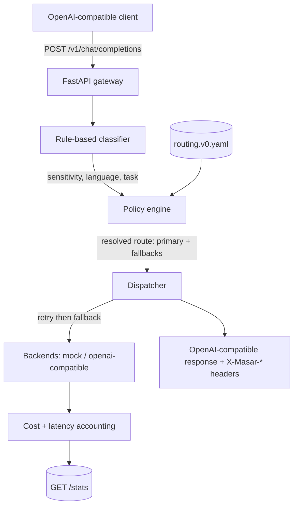

<div align="center">

# masar · مسار

**An OpenAI-compatible LLM gateway that routes every request by data sensitivity, language, and task type - so sensitive traffic stays on sovereign-hosted models and cheap traffic stays off expensive ones, without touching your client code.**

[](https://github.com/SanaAraj/masar/actions/workflows/ci.yml)
[](LICENSE)
[](pyproject.toml)
[](https://github.com/astral-sh/ruff)

<em>masār (مسار) - "path" / "route". The gateway picks the path each request takes.</em>


</div>

> **The demo runs with zero API keys.** Every model above is a deterministic mock
> priced at `$0.00`, so the gateway - and its whole test suite - is fully runnable
> offline. The routing decisions you see are the real thing; only the model
> responses are stubbed.

## What you're seeing

Each request comes back as an unchanged OpenAI response, with the routing decision
surfaced on `X-Masar-*` headers:

| Request | Classified as | Route | Served by |
|---|---|---|---|
| Arabic message containing an email address (PII) | `sovereign / ar / chat` | `sovereign-any` | `mock-sovereign` |
| `What is the capital of Qatar?` | `standard / en / chat` | `default` | `mock-frontier` |
| Request carrying `tools: [...]` | `standard / en / tool_use` | `default` | `mock-frontier` |

`GET /stats` then aggregates requests, tokens, cost, and latency **per route and
model** - the accounting that a capability-aware router is built on.

## Why this exists

Teams serving Arabic and English traffic have to send sensitive requests to
sovereign-hosted models, keep cheap requests off expensive ones, and do both
without rewriting every client. masar sits in front as an OpenAI-compatible
gateway and makes that decision **per request** - from data sensitivity and
language today, and from *measured* model capability once evaluation data exists.
The point is a routing table grounded in measurement rather than vibes.

> **Routing status: heuristic v0 - pending [mizan-evals](https://github.com/SanaAraj/mizan-evals) data.**
> masar routes on operational rules (sensitivity, language, cost) today. It does
> **not** yet route on measured model capability - no capability score exists in
> this repo until mizan-evals results land. The portfolio story is the interlock:
> **mizan measures, masar routes on the measurements.**

## Features

- **OpenAI-compatible** - point any OpenAI client at it; `POST /v1/chat/completions` in, routing out, no client changes.
- **Sovereignty invariant, enforced at startup** - a route marked `sovereign` may only reference sovereign-hosted models; a misconfiguration fails loudly *before* the server accepts traffic.
- **Rule-based classification** - sensitivity (PII / credentials / confidential markers, Luhn-checked), language (Arabic/English by script), and task (chat vs tool_use).
- **Resilient dispatch** - per-route timeouts, retries, and ordered fallbacks, all deterministic under test via an injected clock.
- **Cost + latency accounting** - aggregated by route and model at `GET /stats`, with a structured JSON decision-log line per request.
- **Config-driven** - the whole routing table is one reviewable YAML file; keys live in the environment, never in the config.
- **Runs offline** - mock backends mean the full gateway and its 100+ tests run with no keys and no network.

## Architecture



## Quickstart

```bash
git clone https://github.com/SanaAraj/masar.git
cd masar

# Install (uv shown; a plain venv + pip works too)
uv venv && uv pip install -e ".[dev]"

cp .env.example .env          # the mock backend needs no keys

uv run pytest                 # full suite runs offline (103 tests)

# Start the gateway (mock backend, default heuristic v0 table)
uv run uvicorn masar.app:create_app --factory --port 8000
```

Or with Docker:

```bash
docker compose up --build     # serves on http://localhost:8000
```

### Reproduce the demo

With the gateway running on `:8000`:

```bash
# Arabic request containing PII → routed to the sovereign model
curl -sD - -o /dev/null -X POST http://localhost:8000/v1/chat/completions \
  -H 'Content-Type: application/json' \
  -d '{"messages":[{"role":"user","content":"راسلني على sana@example.com"}]}' \
  | grep -i x-masar

# Plain English chat → the default route
curl -sD - -o /dev/null -X POST http://localhost:8000/v1/chat/completions \
  -H 'Content-Type: application/json' \
  -d '{"messages":[{"role":"user","content":"What is the capital of Qatar?"}]}' \
  | grep -i x-masar

# Aggregated accounting, per route and model
curl -s http://localhost:8000/stats | jq
```

The GIF above is itself reproducible - regenerate it with
[`vhs docs/demo.tape`](docs/demo.tape) ([VHS](https://github.com/charmbracelet/vhs))
while the gateway is running.

## Results

**Headline capability/cost table - Milestone 2 (gated on mizan-evals results):**

| Model set | Quality retained vs frontier | Cost vs frontier | Source |
|---|---|---|---|
| _TBD - pending mizan M2_ | TBD | TBD | mizan-evals run against masar |

No capability, cost, or latency numbers are published in M1 **by design**: the only
active models are mocks priced at `$0.00`, so all reported cost is truthfully zero.
What M1 *does* deliver - the routing behaviour in the table above - is asserted by
[`tests/test_api.py`](tests/test_api.py) and reproducible with the `curl` commands
above.

## Evaluation methodology

**M1 (this milestone)** ships no model-capability numbers. What is verified is the
*routing logic*, by the committed test suite:

- classifier unit tests (Arabic + English; PII, credential, and confidential cases);
- the sovereignty invariant (a sovereign route pointing at a non-sovereign model fails config validation);
- policy resolution and precedence;
- dispatcher fallback, retries, and timeout handling (deterministic via an injected clock);
- an end-to-end gateway test through the mock backend.

**M2 (gated on mizan-evals)** produces the headline table. Capability scores come
from [mizan-evals](https://github.com/SanaAraj/mizan-evals) runs - cached to disk,
seeded, and logged with model ids and dates - and the "quality retained vs cost"
figures are produced by running mizan against masar itself. Until those results
exist, the routing table stays labelled `heuristic v0 - pending mizan M2 data` in
code, config, and this README, and no capability number is invented.

## Limitations

Honest and specific - this section is the point:

- **Routing is heuristic, not capability-driven.** No route reflects measured model quality until mizan M2 data lands.
- **Sensitivity is pattern matching, not NER.** Regex/keyword rules with a Luhn check catch structured PII, credentials, and explicit "confidential" markers. They will miss novel formats and can false-positive (the Saudi national-id shape and `secret:`-style phrases are the loosest). The design is precision-first, so it under-flags rather than over-routes, but both error modes exist.
- **Dialect is a soft signal only.** A small Gulf-marker lexicon matched as whole words; it misses clitic-prefixed forms (`والحين`) and reports a *labelled* `msa-default` when no marker fires - not a positive MSA detection. Dialect is logged but does **not** affect routing in M1.
- **Language detection is script-based.** Mixed Arabic/English is treated as Arabic.
- **Timeouts bound the HTTP call, not a hung process.** A per-route timeout is passed to the backend; masar does not hard-kill a stuck synchronous call in M1.
- **Cost is only as accurate as configured prices.** Only mock models (cost 0) are active, so all reported cost is `$0.00` by construction.
- **No persistence, auth, streaming, or multi-tenant quotas.** `/stats` is in-memory and resets on restart; responses carry a single choice.

## Roadmap

1. **M2:** replace the heuristic table with mizan-derived capability scores and publish "% frontier quality retained at % frontier cost", measured by running mizan against masar.
2. Real providers (OpenAI-compatible and sovereign-hosted) with sourced, dated prices in `cost_source`.
3. Streaming responses, request auth, and per-tenant quotas.
4. A pluggable ML classifier behind the existing `Classifier` protocol, plus dialect-aware routing once dialect capability is measured.
5. Persistent stats with Prometheus metrics and a hard per-request deadline.

## License

MIT - see [LICENSE](LICENSE).
