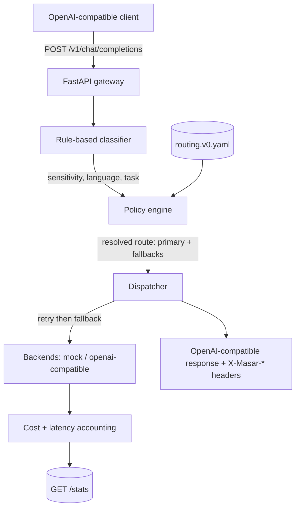

# masar

Eval-driven, sovereignty-aware LLM router: an OpenAI-compatible FastAPI gateway
that routes each request by data sensitivity, language, and task type.

[](https://github.com/SanaAraj/masar/actions/workflows/ci.yml)
[](LICENSE)
[](pyproject.toml)

> _masār_ (مسار) - "path" / "route". The gateway picks the path each request takes.

> **Routing status: heuristic v0 - pending mizan M2 data.** masar routes on
> operational rules (sensitivity, language, cost) today. It does **not** yet
> route on measured model capability: no capability score exists in this
> repository until [mizan-evals](https://github.com/SanaAraj/mizan-evals) results
> land. The portfolio story is the interlock - **mizan measures, masar routes on
> the measurements.**

## Why this exists

Teams serving Arabic and English traffic need to send sensitive requests to
sovereign-hosted models, keep cheap requests off expensive models, and do both
without rewriting clients. masar sits in front as an OpenAI-compatible gateway
and makes that decision per request - from data sensitivity and language now,
and from measured capability once mizan-evals data exists. The point is that the
routing table is grounded in measurement rather than vibes.

## Results

**Headline capability/cost table - Milestone 2 (gated on mizan-evals results):**

| Model set | Quality retained vs frontier | Cost vs frontier | Source |
|---|---|---|---|
| _TBD - pending mizan M2_ | TBD | TBD | mizan-evals run against masar |

No capability, cost, or latency numbers are published in M1 by design; the only
active models are mocks priced at `$0.00`, so all reported cost is truthfully
zero. See [Evaluation methodology](#evaluation-methodology).

**Routing behaviour (M1, reproducible)** - the concrete thing M1 delivers, each
row asserted by [`tests/test_api.py`](tests/test_api.py) and reproducible with
the quickstart `curl`:

| Example request | Classified as | Route | Served by |
|---|---|---|---|
| `What is the capital of Qatar?` | `standard / en / chat` | `default` | `mock-frontier` |
| `راسلني على sana@example.com` | `sovereign / ar / chat` | `sovereign-any` | `mock-sovereign` |
| request with `tools: [...]` | `standard / en / tool_use` | `default` | `mock-frontier` |

## Architecture



The sovereignty invariant is enforced at startup: a route marked `sovereign`
may only reference sovereign-hosted models, and a misconfiguration fails loudly
before the server accepts traffic.

## Quickstart

```bash
git clone https://github.com/SanaAraj/masar.git
cd masar

# Install (uv shown; plain venv + pip works too)
uv venv && uv pip install -e ".[dev]"

cp .env.example .env          # the mock backend needs no keys

uv run pytest                 # full suite runs offline

# Start the gateway (mock backend, default heuristic v0 table)
uv run uvicorn masar.app:create_app --factory --port 8000
```

Or with Docker:

```bash
docker compose up --build     # serves on http://localhost:8000
```

## Usage examples

**Arabic request containing PII → routed to the sovereign model.** The request
body is unchanged OpenAI; the routing decision comes back on `X-Masar-*` headers:

```console
$ curl -i -X POST http://localhost:8000/v1/chat/completions \
    -H 'Content-Type: application/json' \
    -d '{"messages":[{"role":"user","content":"راسلني على sana@example.com"}]}'

HTTP/1.1 200 OK
content-type: application/json
x-masar-request-id: req-f9d86aeb38ab
x-masar-route: sovereign-any
x-masar-model: mock-sovereign
x-masar-classification: sovereign/ar/chat
x-masar-cost-usd: 0.000000
x-masar-latency-ms: 0.316
x-masar-fallback-used: false
```

**Plain English chat → the default route:**

```console
$ curl -s -X POST http://localhost:8000/v1/chat/completions \
    -H 'Content-Type: application/json' \
    -d '{"messages":[{"role":"user","content":"What is the capital of Qatar?"}]}' \
    -D - -o /dev/null | grep -i x-masar

x-masar-route: default
x-masar-model: mock-frontier
x-masar-classification: standard/en/chat
```

**Aggregated accounting** by route and model, with routing provenance surfaced:

```console
$ curl -s http://localhost:8000/stats
{"routing_label":"heuristic v0 - pending mizan M2 data",
 "cost_source":"mock models only (cost 0); ...",
 "totals":{"requests":1,"errors":0,"prompt_tokens":3,"completion_tokens":2,"cost_usd":0.0},
 "by_route_model":[{"route":"sovereign-any","model":"mock-sovereign","requests":1, ...}]}
```

Every request also emits a structured JSON decision log line recording the
classification, the signals that fired, each backend attempt, and the resulting
usage, cost, and latency.

## Evaluation methodology

**M1 (this milestone)** ships no model-capability numbers. What is verified is
the *routing logic*, by the committed test suite:

- classifier unit tests (Arabic + English, PII/credential/confidential cases);
- the sovereignty invariant (a sovereign route pointing at a non-sovereign model
  fails config validation);
- policy resolution and precedence;
- dispatcher fallback, retries, and timeout handling (deterministic via an
  injected clock);
- an end-to-end gateway test through the mock backend.

**M2 (gated on mizan-evals)** produces the headline table. Capability scores come
from [mizan-evals](https://github.com/SanaAraj/mizan-evals) runs - cached to
disk, seeded, and logged with model ids and dates - and the "quality retained
vs cost" figures are produced by running mizan against masar itself. Until those
results exist, the routing table stays labelled `heuristic v0 - pending mizan M2
data` in code, config, and this README, and no capability number is invented.

## Limitations

Honest and specific - this section is the point:

- **Routing is heuristic, not capability-driven.** No route reflects measured
  model quality until mizan M2 data lands.
- **Sensitivity is pattern matching, not NER.** Regex/keyword rules with a Luhn
  check catch structured PII, credentials, and explicit "confidential" markers.
  They will miss novel formats and can false-positive (the Saudi national-id
  shape and `secret:`-style phrases are the loosest). The design is
  precision-first, so it under-flags rather than over-routes, but both error
  modes exist.
- **Dialect is a soft signal only.** A small Gulf-marker lexicon matched as whole
  words; it misses clitic-prefixed forms (`والحين`) and reports a *labelled*
  `msa-default` when no marker fires - not a positive MSA detection. Dialect is
  logged but does **not** affect routing in M1.
- **Language detection is script-based.** Mixed Arabic/English is treated as
  Arabic.
- **Timeouts bound the HTTP call, not a hung process.** A per-route timeout is
  passed to the backend; masar does not hard-kill a stuck synchronous call in M1.
- **Cost is only as accurate as configured prices.** Only mock models (cost 0)
  are active, so all reported cost is `$0.00` by construction.
- **No persistence, auth, streaming, or multi-tenant quotas.** `/stats` is
  in-memory and resets on restart; responses carry a single choice.

## Roadmap

1. **M2:** replace the heuristic table with mizan-derived capability scores and
   publish "% frontier quality retained at % frontier cost", measured by running
   mizan against masar.
2. Real providers (OpenAI-compatible and sovereign-hosted) with sourced, dated
   prices in `cost_source`.
3. Streaming responses, request auth, and per-tenant quotas.
4. A pluggable ML classifier behind the existing `Classifier` protocol, plus
   dialect-aware routing once dialect capability is measured.
5. Persistent stats with Prometheus metrics and a hard per-request deadline.

## License

MIT - see [LICENSE](LICENSE).
